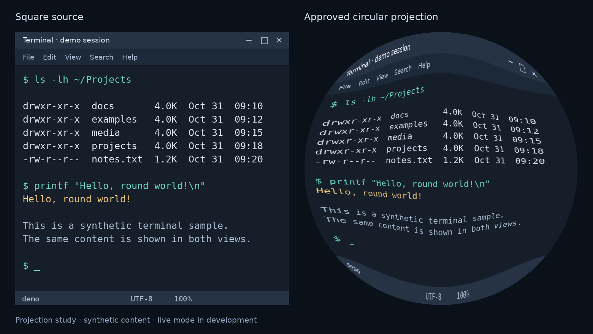

# Linux Rond

**A desktop shaped for circular touchscreens.**

Linux Rond adapts KDE Plasma to round displays: controls follow the edge, windows stay
inside the visible area, and a single tap wakes the screen. It is built for small touch
monitors, embedded displays, and custom Linux devices where a rectangular desktop wastes space.


*Projection study using synthetic content. The native workspace is experimental.*

## What it does

| Feature | Status |
| --- | --- |
| Top and bottom panels arranged along an arc | Available |
| Tilted icons and curved window-state indicators | Available |
| Safe square window placement inside the display | Available |
| Wake the display with one touch | Available; tested on KWin 6.8.1 |
| Balanced square-to-circle projection | Experimental native KWin effect |
| Matching mouse and touch coordinates after projection | Experimental; integration-tested |
| Saved square/circular mode for each application | Experimental; new-process persistence tested |
| Touch-friendly window overview with packed bubbles | Experimental; visual review ongoing |
| Drag-to-split workspace with two half-disks | Experimental; portrait canvases |

The experimental circular mode uses the same geometry for rendering and input, with window
controls in the top arc. In split-screen, each half has its own controls; leaving the
split restores each application's saved shape. See the [roadmap](docs/ROADMAP.md).

## Requirements

- A Linux desktop running **KDE Plasma 6 on Wayland**.
- A circular display exposed as a square output; touchscreen recommended.
- `kpackagetool6`, `kwriteconfig6`, `qdbus6`, Python 3, and the
  `plasma-plasmashell.service` user service.

The native wakeup plugin additionally needs C++23, CMake, and matching KWin/Qt/KF
development files. GNOME and other compositors are not currently supported.

## Get started

```sh
git clone https://github.com/softyoda/linux-rond.git
cd linux-rond
./scripts/install.sh
```

This installs the panel component and enables safe-area window placement for your user.
To create the arc panels:

```sh
./scripts/configure-panels.sh
```

**This replaces panels on the single square output**, saves the previous layout, and
restarts Plasma. Other outputs are unchanged. Multiple square outputs require explicit
configuration. Adjust scaling in System Settings → Display.

To enable single-tap wakeup:

```sh
./scripts/install-touch-wakeup.sh
```

The screen wakes after you lift your finger. The plugin does not unlock the session,
change the idle timeout, or wake a suspended computer. It loads automatically at login;
re-run the installer after a KWin update to rebuild it for the new version.

## Experimental native workspace

The native effect projects real application windows and maps pointer/touch input through
the same geometry. Square mode has straight corners; only overview thumbnails use rounded corners.
The optional [workspace installer](docs/WORKSPACE.md) includes version checks and rollback:

```sh
./scripts/install-workspace.sh --prepare
# After reviewing the supported cases and limitations:
./scripts/install-workspace.sh --enable
./scripts/disable-workspace.sh
```

For native Firefox vertical tabs in a chosen profile:

```sh
python3 scripts/configure-firefox.py --profile /path/to/firefox/profile
```

This preserves existing `user.js` settings and writes a managed preference block.
Firefox reads it on startup. It is independent of the workspace on/off setting.

## Check or restore

```sh
./scripts/check.sh
./scripts/disable-touch-wakeup.sh
./scripts/restore-panels.sh /path/to/backup
```

Restoring the saved layout also disables safe-area placement. All installation is
per-user; these scripts do not install system packages.

## Development

```sh
./scripts/check-source.sh
# Rebuild the projection image; requires NumPy and Pillow.
python3 tools/render_projection_preview.py
```

Bug reports should include the distribution, Plasma/KWin versions, display resolution,
and input devices. Contributions are welcome; use concise English comments and documentation.
Compositor changes are tested in an isolated session before deployment.

[Validation tracker and screenshots](docs/VALIDATION.md) · [Roadmap](docs/ROADMAP.md) · [Projection mesh](projection/approved-mesh.json) · [OBJ with UVs](projection/approved-mesh.obj)

Licensed under [GPL-2.0-or-later](LICENSE).
